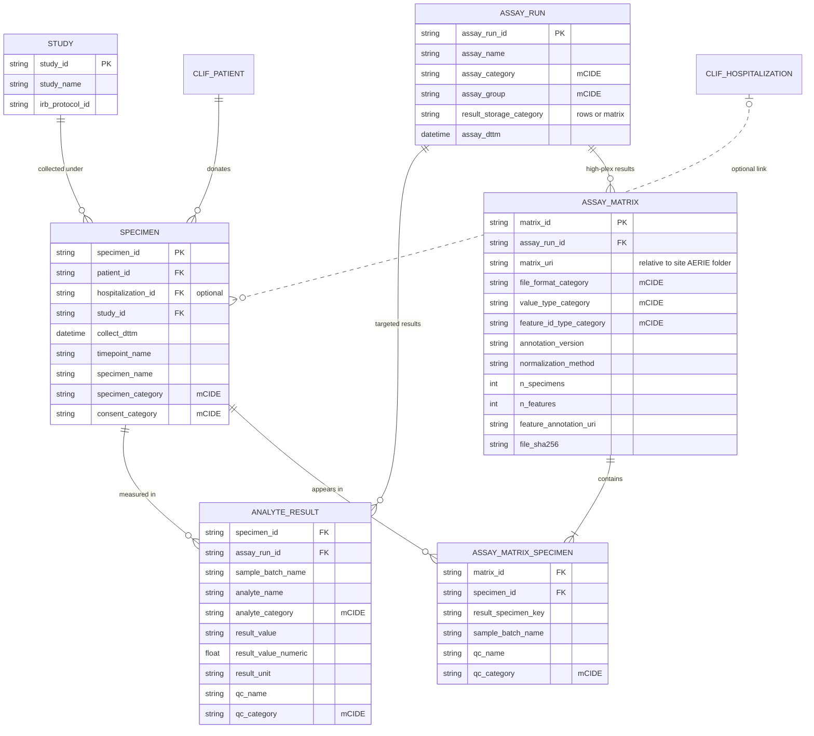

# AERIE: Augmenting EHR Research with ICU biospEcimens

[](LICENSE)


AERIE is a biospecimen data standard for the [CLIF Consortium](https://clif-icu.com/). Several CLIF sites hold research biobanks. AERIE describes those specimens and their assay results in six tables that join by patient to the [Common Longitudinal ICU data Format (CLIF)](https://github.com/Common-Longitudinal-ICU-data-Format/CLIF) EHR tables, and it is being developed alongside CLIF 3.0. Investigators can then align a cytokine level or a transcriptome with the ventilator settings, medications, and outcomes CLIF already records.

AERIE is a nested study within the CLIF cohort, and the repository follows CLIF's layout: a data dictionary in `ddl/` and controlled vocabularies (mCIDE, the minimum Common ICU Data Elements) in `mCIDE/`.

## Design decisions

- **Federated, as in CLIF.** Nothing is pooled. AERIE tables and matrix files stay at each site, analysis code runs locally, and only results leave the site.
- **An easily exported subset, not a lab database.** AERIE holds one specimen row per collection and specimen type, with the fields an analysis needs. Aliquots, freezer locations, chain of custody, and shipping stay in each site's biorepository system.
- **Research assays only.** Central-lab results, such as a clinical procalcitonin or D-dimer, belong in CLIF `labs`. AERIE holds results from research assays run on banked specimens.
- **Targeted results as rows, high-plex results as files.** A targeted assay writes one row per analyte to `analyte_result`. A high-plex assay writes one specimen-by-feature file per run and points to it from `assay_matrix`, so an RNA-seq sample becomes one link row instead of tens of thousands of result rows.
- **One approach for every Olink version.** Target 48, Target 96, Explore, and Explore HT all write a matrix file, so a site's Olink code does not depend on panel size. SomaScan does the same.
- **Specimens key on patient and time, not encounter.** Research specimens may be drawn outside a hospitalization, so `hospitalization_id` is optional.
- **Consent sits on the specimen.** Each specimen records the study it was collected under and its consent; there is no enrollment table.

## Tables



| Table | One row per | Purpose |
|---|---|---|
| `study` | study or biobank protocol | Name and IRB protocol |
| `specimen` | collection and specimen type | Links a specimen to a CLIF patient, a time, a study, and its consent |
| `assay_run` | assay run | Platform, run date, and whether results are rows or files |
| `analyte_result` | specimen, run, and analyte | One value for one named analyte from a targeted assay |
| `assay_matrix` | result file | Points to a specimen-by-feature file and says what its cells and columns hold |
| `assay_matrix_specimen` | specimen per file | Lists the specimens in each file, with per-specimen batch and QC |

`patient_id` on `specimen` is the join key to CLIF; each site maps its biobank participant IDs to CLIF patient IDs during ETL. `collect_dttm` is required: it anchors each result against the clinical record, and analysts place a specimen within a hospitalization by comparing it with `admission_dttm` and `discharge_dttm`. `sample_batch_name` sits on the result rows rather than the run, because one run can span several plates or lanes.

The full definitions are in [`ddl/0.1/AERIE0.1_MYSQL_ddl.sql`](ddl/0.1/AERIE0.1_MYSQL_ddl.sql). As in CLIF, each column's `COMMENT` holds a JSON description and its permissible values.

### Rows or matrix

The `result_storage` column of [`aerie_assay_categories.csv`](mCIDE/assay_run/aerie_assay_categories.csv) assigns each platform to `rows` or `matrix`. ELISA, Luminex, qPCR, and targeted genotyping are rows. Olink, SomaScan, mass-spectrometry proteomics, sequencing, and arrays are matrices. For a platform marked `either`, such as metabolomics or cytometry, the deliverable decides: a quantified value for a named analyte, such as monocyte HLA-DR, goes to `analyte_result`; a feature table goes to `assay_matrix`. Each run records its choice in `result_storage_category`.

### Matrix files

- Specimens are rows and features are columns. The row key is `specimen_id`, or `result_specimen_key` when the file uses another ID; in AnnData that is the `obs` index.
- Use Parquet for proteomics and metabolomics and h5ad for transcriptomics where possible.
- `matrix_uri` is relative to the site's AERIE folder. Files never leave the site, so the path only has to resolve locally.
- Plate controls and bridging samples may stay in the file but get no `assay_matrix_specimen` row.
- `assay_matrix_specimen` lets a validator check consent and specimen keys without opening the file. To drop a withdrawn specimen, filter on `consent_category`, then read only the remaining rows.

### A flat view for analysts

Analysts who want one long table, as with CLIF `labs`, can join the targeted tables:

```sql
SELECT s.patient_id, s.collect_dttm, s.specimen_category, a.assay_category,
       r.analyte_category, r.result_value_numeric, r.result_unit, r.qc_category
FROM analyte_result r
JOIN specimen s USING (specimen_id)
JOIN assay_run a USING (assay_run_id)
WHERE s.consent_category <> 'withdrawn';
```

## Conventions

AERIE follows CLIF 3.0 conventions. Raw source strings go in `*_name` columns, and each maps to a controlled vocabulary in the paired `*_category` column (`assay_name` → `assay_category` → `assay_group`). Category values are lowercase snake_case. Every datetime is timezone-aware and in UTC, formatted `YYYY-MM-DD HH:MM:SS+00:00`. Sites load values as recorded, without clipping or filtering outliers.

## Repository layout

| Path | Contents |
|---|---|
| `ddl/<version>/` | Data dictionary as MySQL DDL |
| `mCIDE/<table>/` | Vocabularies used by one table |
| `mCIDE/common/` | QC status, used by `analyte_result` and `assay_matrix_specimen` |
| `schemas/<version>/` | YAML schemas in [clifpy](https://github.com/Common-Longitudinal-ICU-data-Format/clifpy)'s format, one per table, for validating a site's tables |
| `docs/` | Superseded single-table draft, kept for reference |
| `scripts/check_consistency.py` | Confirms that the DDL, the mCIDE CSVs, and the YAML schemas agree |

Run the consistency check after editing the DDL, a vocabulary, or a schema:

```bash
uv run scripts/check_consistency.py
```

## Validating a site's tables with clifpy

clifpy loads its built-in schemas by CLIF table name, so it does not find AERIE's on its own. Pass an AERIE schema to clifpy's validator directly:

```python
import yaml
from clifpy.utils.validator import validate_dataframe

schema = yaml.safe_load(open("schemas/0.1/analyte_result_schema.yaml"))
validation_issues = validate_dataframe(analyte_result_df, schema)
```

The validator checks required columns, data types, UTC datetimes, permissible values, and, for `assay_run`, the mapping from `assay_category` to `assay_group`. It checks one table at a time; it does not check keys across tables. It also reports each vocabulary value absent from the table as an "mCIDE coverage gap"; a site with blood and urine only will see the other specimen types listed there, which is expected.

## Open questions

- `result_unit` has no controlled vocabulary yet, and the units sites report for the same analyte still need checking against each site's kits.
- Whether raw files (FASTQ, BAM, IDAT, mzML) belong in `assay_matrix` at all, given that AERIE is an exported subset. The file format vocabulary still lists them.
- Each specimen belongs to the one study it was collected under. If sites need to record a specimen's use under a second study, `specimen` may need `(specimen_id, study_id)` as its key.

## License

Apache 2.0, matching CLIF.
